# Assignment 2: Creating a Web-Based Command-Line Interface and Implementing Command Injection Protection

## 1. Introduction

Command injection is a security vulnerability that occurs when an application processes user input in a way that allows unauthorized operating-system commands to be executed. This vulnerability may allow attackers to access sensitive information, modify files, or perform unauthorized operations on a system.

This assignment involves developing a web-based command-line interface (CLI) using HTML, CSS, JavaScript, Node.js, and Express.js. The application allows users to enter predefined commands through a web browser and view the corresponding output.

Security measures, including input validation, command allowlisting, and avoiding operating-system shell execution, are implemented to prevent command injection. The application is also tested using valid commands, invalid inputs, and common command-injection payloads.

## 2. Objectives

The main objectives of this assignment are:

- To create a web-based command-line interface.
- To develop a backend API using Node.js and Express.js.
- To connect the frontend with the backend.
- To implement input validation and command allowlisting.
- To prevent command injection by avoiding shell execution of user input.
- To test the application using valid commands and malicious inputs.
- To document the implementation and testing results with screenshots.

## 3. Tools and Technologies Used

| Tool or technology | Purpose |
|---|---|
| Kali Linux | Development and testing environment |
| Node.js | Runs the backend JavaScript application |
| npm | Installs and manages project dependencies |
| Express.js | Creates the backend API |
| HTML | Structures the web interface |
| CSS | Styles the terminal interface |
| JavaScript | Handles user input and communicates with the backend |
| Helmet | Adds HTTP security headers |
| Express Rate Limit | Limits repeated API requests |
| Firefox | Tests the web application |
| curl | Sends HTTP requests to test the backend |

## 4. Implementation

### 4.1 Step 1: Check the Kali Linux Environment

The development environment was prepared using Kali Linux. Node.js and npm were checked to ensure that JavaScript applications could be executed and the required dependencies installed.

The following commands were used:

```bash
node --version
npm --version
```

The installed Node.js and npm versions were checked before starting the project.

**Evidence:**

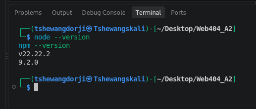

### 4.2 Step 2: Create the Project

A project directory named `secure-web-cli` was created inside the `Web404_A2` directory. npm was initialized to create the `package.json` file, which stores project metadata and dependency information.

The project was created using the following commands:

```bash
mkdir secure-web-cli
cd secure-web-cli
npm init -y
npm install express helmet express-rate-limit
```

The required dependencies were installed to support backend development and security controls.

**Evidence:**

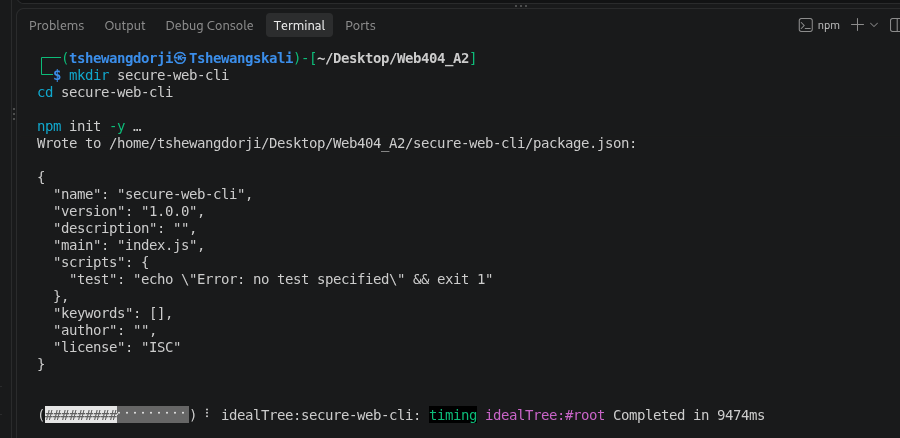

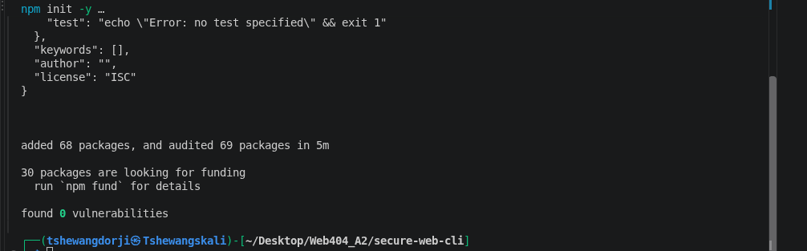

### 4.3 Create the Frontend Folder

A `public` directory was created to store the frontend files served by Express.js.

The following files were created:

- `index.html` — defines the web interface.
- `style.css` — controls the appearance of the interface.
- `script.js` — handles command submission and displays backend responses.

The project structure is shown below:

```text
secure-web-cli/
├── node_modules/
├── public/
│   ├── index.html
│   ├── style.css
│   └── script.js
├── package.json
├── package-lock.json
└── server.js
```

**Evidence:**

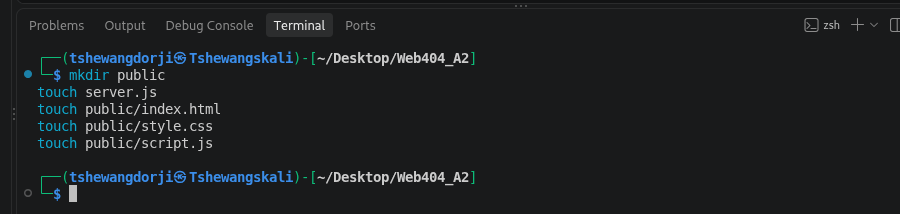

### 4.4 Step 3: Create the Backend

The backend was implemented in `server.js` using Node.js and Express.js. It defines an API endpoint at `/api/command` to receive commands submitted by the frontend.

The backend performs the following operations:

1. Receives the command through an HTTP POST request.
2. Checks that the input is a string.
3. Checks that the command length is within the permitted range.
4. Validates the input against an allowed character pattern.
5. Checks whether the command exists in the predefined allowlist.
6. Returns the corresponding output or an error response.

The application supports three commands: `help`, `status`, and `version`.

Helmet is used to add security-related HTTP headers, while Express Rate Limit restricts repeated API requests. A JSON request-size limit is also configured.

Most importantly, the application does not execute user-provided input through an operating-system shell. Instead, each permitted command maps to a predefined function that returns a fixed response.

**Evidence:**

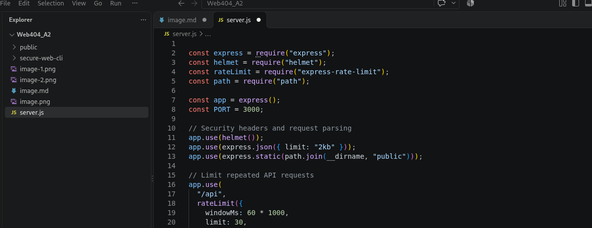

### 4.5 Step 4: Create the Web Interface

The frontend was created using HTML in `public/index.html`.

The interface contains:

- The application title.
- A list of supported commands.
- A command input field.
- A Run button.
- An output section.
- A security information footer.

The user enters a command into the input field and submits it to the backend. The output section displays the response returned by the API.

**Evidence:**

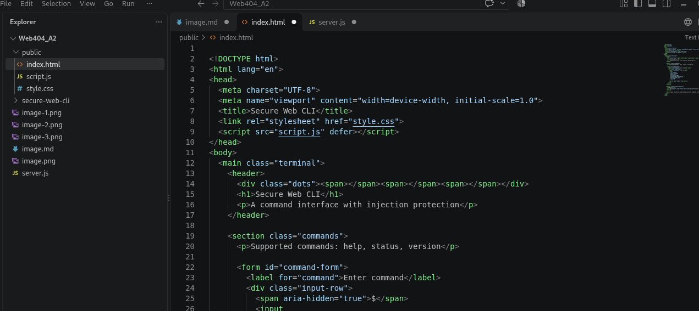

### 4.6 Step 5: Design the Terminal Using CSS

CSS was added in `public/style.css` to make the application resemble a terminal interface.

The interface uses a dark background, contrasting text, a highlighted command input, and a separate output panel. The layout was designed to remain usable at different screen sizes.

These styling choices improve readability and help users distinguish the input field from the command output.

**Evidence:**

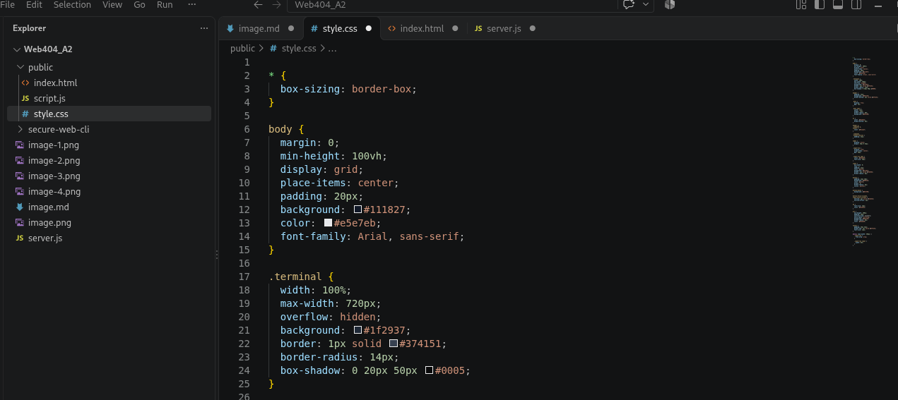

### 4.7 Step 6: Connect the Frontend to the Backend

The frontend and backend were connected using JavaScript in `public/script.js`.

When the user submits a command, JavaScript sends an HTTP POST request to `/api/command` using the Fetch API. The command is transmitted as JSON.

The frontend processes the returned JSON response and displays the result in the output section.

The `textContent` property is used to display the response as text rather than interpreting it as HTML. This provides an additional safeguard against HTML injection through the output.

**Evidence:**

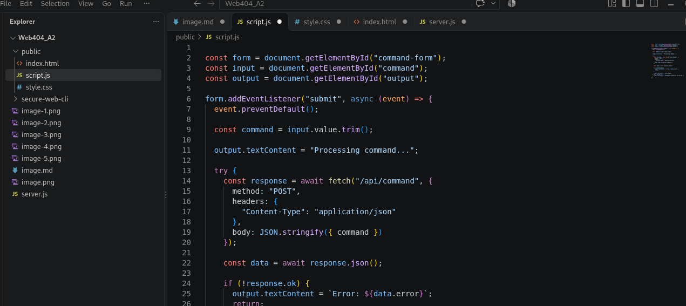

### 4.8 Step 7: Run the Application

The backend was started from the project directory using:

```bash
node server.js
```

The server displayed the following message:

```text
Secure Web CLI running at http://localhost:3000
```

The application was then opened in Firefox using:

```text
http://localhost:3000
```

After the frontend files were correctly saved and named, the web interface loaded successfully.

**Evidence:**

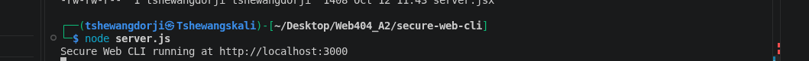

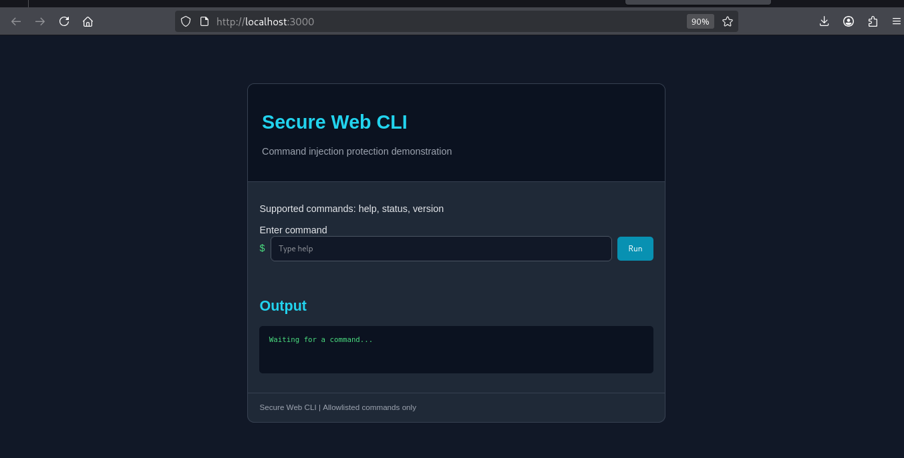

## 5. Security Implementation

### 5.1 Input Validation

The backend validates the command before processing it. It checks the input type, length, and permitted characters.

For example, the backend rejects inputs containing spaces, semicolons, parentheses, or other characters that are not permitted by the command format.

Input validation helps prevent malformed and unexpected input from being accepted.

### 5.2 Command Allowlisting

The application uses an allowlist containing the following commands:

- `help`
- `status`
- `version`

Only these predefined commands are accepted. An unsupported command such as `whoami` is rejected.

Allowlisting limits the functionality exposed to the user and prevents arbitrary command requests from being treated as valid application commands.

### 5.3 Avoiding Operating-System Shell Execution

The backend maps each supported command to a predefined JavaScript function. It does not pass the submitted command to `exec()`, `execSync()`, or another shell-execution function.

This is the primary command-injection safeguard in the application. Even if an attacker submits shell operators or command-substitution syntax, the application has no mechanism that executes those strings as operating-system commands.

### 5.4 Secure Output Handling

The frontend uses `textContent` to display command output. This prevents returned text from being interpreted as HTML markup.

### 5.5 Additional Security Controls

The application uses Helmet for HTTP security headers, Express Rate Limit to restrict repeated requests, and a JSON body-size limit to reduce the risk of excessively large request bodies.

These controls complement the allowlist and input validation but do not replace the need to avoid unsafe command execution.

## 6. Testing and Results

Testing was performed through the web interface and the command line. The purpose was to verify that supported commands work correctly and unauthorized inputs are rejected.

### 6.1 Test A: Supported Commands

Three supported commands were tested through the web interface.

#### Test 1: `help`

The `help` command displays the available commands.

Expected output:

```text
Available commands: help, status, version
```

**Evidence:**

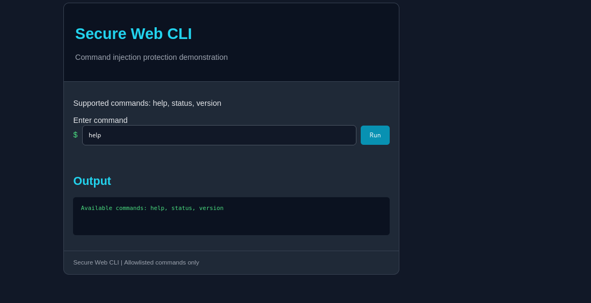

#### Test 2: `status`

The `status` command displays the application status.

Expected output:

```text
System status: Secure Web CLI is running.
```

**Evidence:**

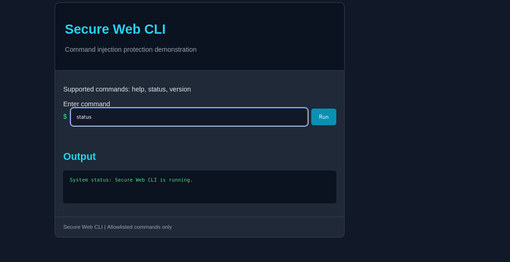

#### Test 3: `version`

The `version` command displays the application version.

Expected output:

```text
Secure Web CLI version 1.0.0
```

**Evidence:**

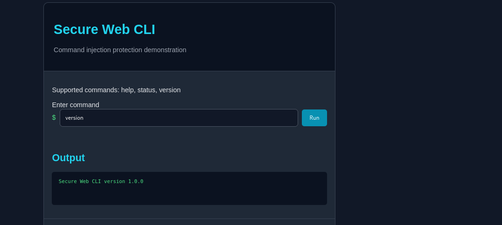

### 6.2 Test B: Normal Backend Request

A valid command was submitted directly to the backend using `curl`.

The following command was used:

```bash
curl -i -X POST http://localhost:3000/api/command \
  -H "Content-Type: application/json" \
  -d '{"command":"status"}'
```

The expected response is HTTP `200 OK`, with the application status returned in JSON format.

**Evidence:**

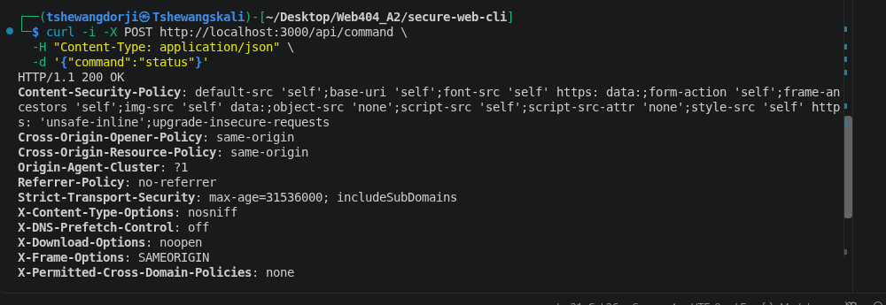

### 6.3 Test C: Command-Injection Attempts Through the Web Interface

Several invalid and potentially malicious inputs were submitted through the application interface.

#### Test 1: Command Separator

**Input:**

```text
status; whoami
```

A semicolon can separate commands in a shell. An unsafe application might interpret the second part as another command.

The application should reject this input because it contains characters outside the permitted command format.

**Expected result:** HTTP `400 Bad Request` from the API, with an invalid-input error displayed in the interface.

**Evidence:**


#### Test 2: Command Chaining

**Input:**

```text
status && id
```

The `&&` operator can be used to execute a second shell command when the first command succeeds.

The application should reject this input during character validation. It must not execute either part as an operating-system command.

**Evidence:**

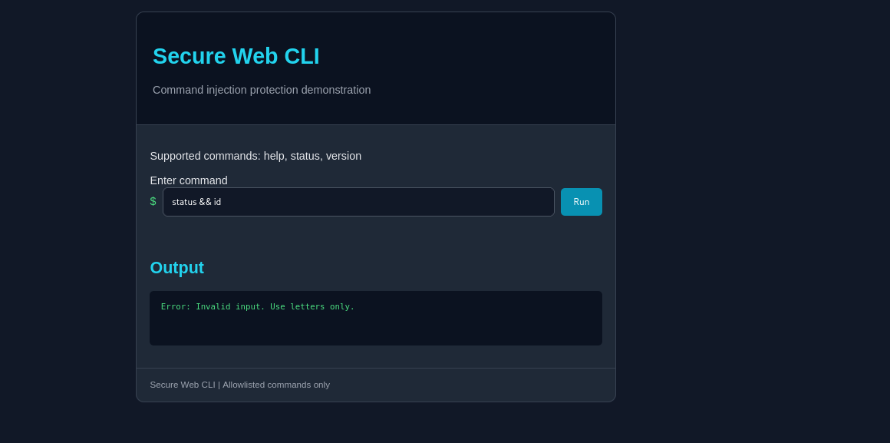

#### Test 3: Command Substitution

**Input:**

```text
$(whoami)
```

Shell command substitution can cause a shell to execute a command and substitute its output into an expression.

The application should reject this input because the characters do not match the permitted command format.

**Evidence:**


#### Test 4: Unknown Command

**Input:**

```text
whoami
```

The `whoami` command is not included in the application's allowlist. The backend should reject it with a command-not-allowed error.

**Evidence:**


#### Test 5: Invalid Characters

**Input:**

```text
status123
```

This input contains digits, which are not permitted by the application's lowercase-letter validation pattern.

The backend should reject the request with an invalid-input error.

**Evidence:**

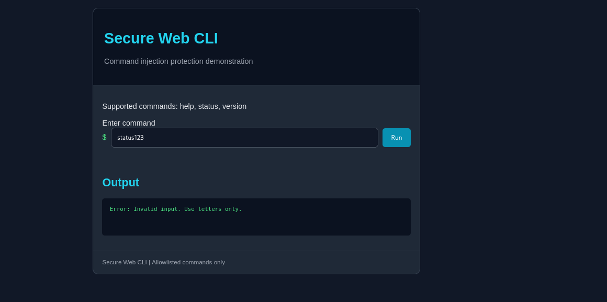

#### Test 6: Long Input

An input containing 51 characters was submitted.

The backend permits commands with a maximum length of 50 characters. Therefore, the request should be rejected with an input-length error.

**Evidence:**

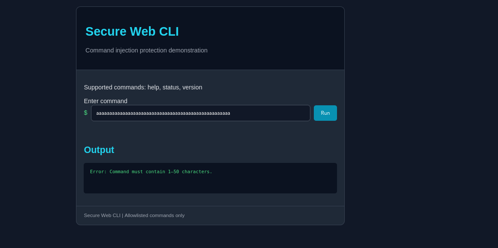

### 6.4 Test D: Command-Line Security Testing

Additional tests were performed directly against the API using `curl`. These tests verify the backend independently of the frontend.

#### Test 1: Command Separator

The following command was used:

```bash
curl -i -X POST http://localhost:3000/api/command \
  -H "Content-Type: application/json" \
  -d '{"command":"status; whoami"}'
```

The backend should return HTTP `400 Bad Request` because the submitted input contains invalid characters. The operating-system command `whoami` must not execute.

**Evidence:**

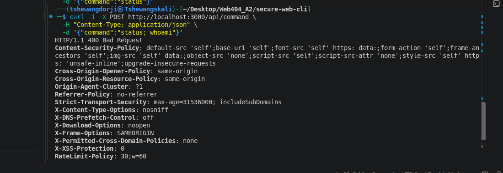

#### Test 2: Command Chaining

The following command was used:

```bash
curl -i -X POST http://localhost:3000/api/command \
  -H "Content-Type: application/json" \
  -d '{"command":"status && id"}'
```

The backend should reject the input because the command contains spaces and shell operators.

**Evidence:**

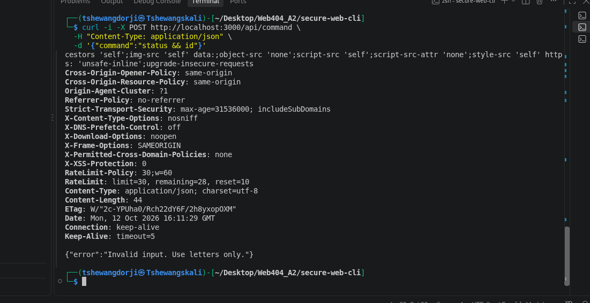

#### Test 3: Long Input

The following command generates a string containing 51 characters and submits it to the API:

```bash
curl -i -X POST http://localhost:3000/api/command \
  -H "Content-Type: application/json" \
  -d "{\"command\":\"$(printf 'a%.0s' {1..51})\"}"
```

The backend should return HTTP `400 Bad Request` because the command exceeds the maximum permitted length.

**Evidence:**

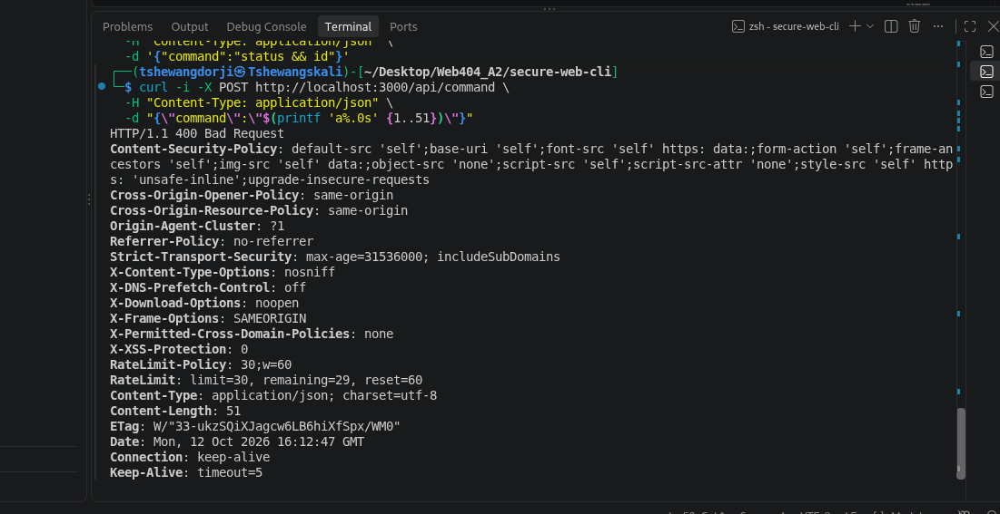

### 6.5 Summary of Test Cases

| No. | Test case | Expected result |
|---:|---|---|
| 1 | `help` | Accepted; displays supported commands |
| 2 | `status` | Accepted; displays application status |
| 3 | `version` | Accepted; displays version information |
| 4 | `status; whoami` | Rejected by input validation |
| 5 | `status && id` | Rejected by input validation |
| 6 | `$(whoami)` | Rejected by input validation |
| 7 | `whoami` | Rejected by the allowlist |
| 8 | `status123` | Rejected by input validation |
| 9 | 51-character input | Rejected by length validation |
| 10 | Valid `status` API request | HTTP `200 OK` |
| 11 | Injection attempt through the API | HTTP `400 Bad Request` |

The expected results above describe the application's intended behavior. The actual result of each test should be confirmed against the captured terminal output or browser screenshot before submission.

## 7. Limitations

The application implements a simulated CLI rather than a general-purpose system terminal. It supports only three predefined commands and returns fixed responses.

This design intentionally restricts functionality to reduce security risks. Additional commands would require careful design and testing to ensure they do not introduce unsafe execution paths.

The application is a local demonstration and has not been presented as a production-ready service.

## 8. Conclusion

This assignment involved developing a web-based command-line interface and implementing safeguards against command injection.

The application was built using HTML, CSS, JavaScript, Node.js, and Express.js. The frontend communicates with the backend through an HTTP API, while the backend validates submitted commands and accepts only those included in a predefined allowlist.

The primary security measure is avoiding operating-system shell execution of user input. Input validation, secure output handling, Helmet, rate limiting, and request-size restrictions provide additional safeguards.

Testing with supported commands, unknown commands, invalid characters, shell operators, command substitution, and oversized input demonstrates how the application is designed to distinguish valid requests from unauthorized input.

Overall, the project demonstrates the importance of secure input handling, allowlisting, and avoiding unsafe command execution when building web applications that provide command-line-style functionality.

## 9. References

1. OWASP Foundation. (n.d.). *OS command injection*. OWASP. https://owasp.org/www-community/attacks/Command_Injection
2. OWASP Foundation. (n.d.). *OS command injection defense cheat sheet*. OWASP Cheat Sheet Series. https://cheatsheetseries.owasp.org/cheatsheets/OS_Command_Injection_Defense_Cheat_Sheet.html
3. Express.js. (n.d.). *Express - Node.js web application framework*. https://expressjs.com/
4. Node.js. (n.d.). *Node.js documentation*. https://nodejs.org/docs/latest/api/
